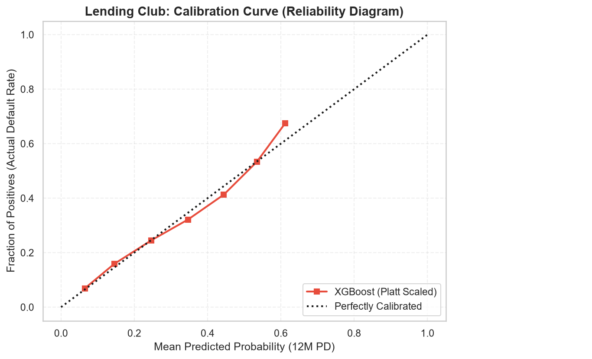
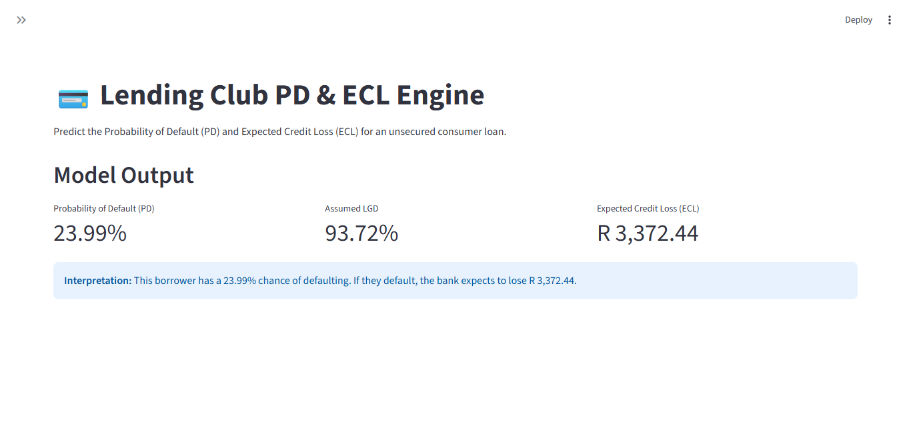

# Credit-Risk-IFRS9-Engine
End-to-end Lending Club PD &amp; ECL model with Streamlit deployment.

# Lending Club IFRS 9 Engine (Cross-Sectional)

## Overview
This repository contains an end-to-end quantitative credit risk model built on a 1.34M loan dataset (Lending Club, 2007–2018). It demonstrates Probability of Default (PD) modeling, model calibration, LGD estimation, and Expected Credit Loss (ECL) calculations. 

The full end-to-end data pipeline and modeling process can be found in `Lending_Club_IFRS9_Model.ipynb`.

## How to Run the Dashboard
To run the interactive Streamlit dashboard locally:
1. Ensure `xgboost`, `streamlit`, `pandas`, and `joblib` are installed.
2. Run: `streamlit run app1.py`

---

## Key Features
*   **Data Engineering & Audit Trail:** Extracted a 150,000-loan stratified sample to preserve historical vintage bad rates. A full data cleaning audit trail is available in `data_cleaning_audit_log.csv`.
*   **Modeling:** Trained a Champion Logistic Regression and an XGBoost Challenger. 
*   **Calibration:** Applied Platt Scaling to align predicted PDs with actual default rates, fixing the over-provisioning issue caused by class weights.
*   **LGD Estimation:** Calculated historical unsecured LGD at 93.7%.
*   **Stress Testing:** Built a macroeconomic sensitivity engine (0.5x to 2.5x PD shocks).

## Model Calibration & Validation

*Figure 1: Calibration Curve (Platt Scaling). Proves the predicted PDs align perfectly with actual default rates across all risk deciles.*

## Interactive Dashboard: `app1.py`

**1. Prime Borrower Scenario (Low Risk)**

**2. Risky Borrower Scenario (High Risk)**
By adjusting the borrower profile to a subprime FICO score (580), high DTI (45%), and a history of delinquencies, the model dynamically recalculates the Probability of Default and Expected Credit Loss, demonstrating its sensitivity to borrower credit behaviour.

---
**Author:** Raymond Sibanda | [LinkedIn](https://www.linkedin.com/in/raymond-sibanda)
FRM | BSc Mathematics | BCom Honours
